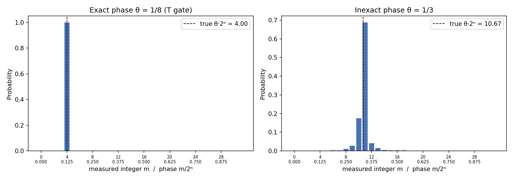
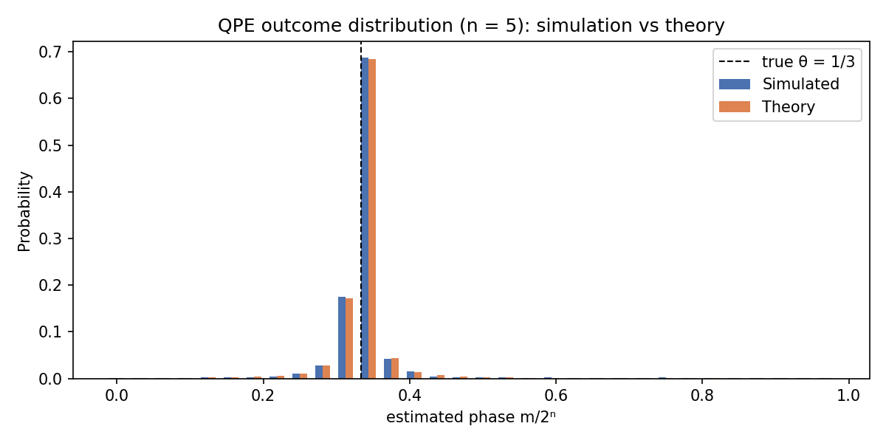
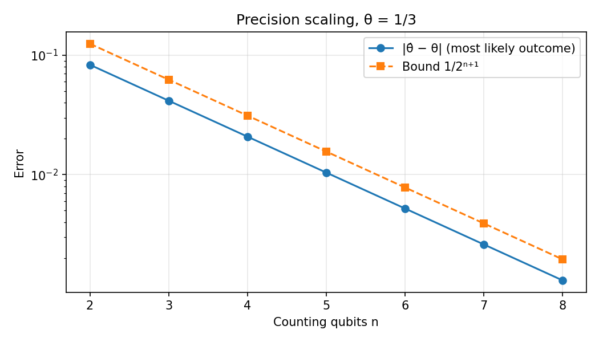
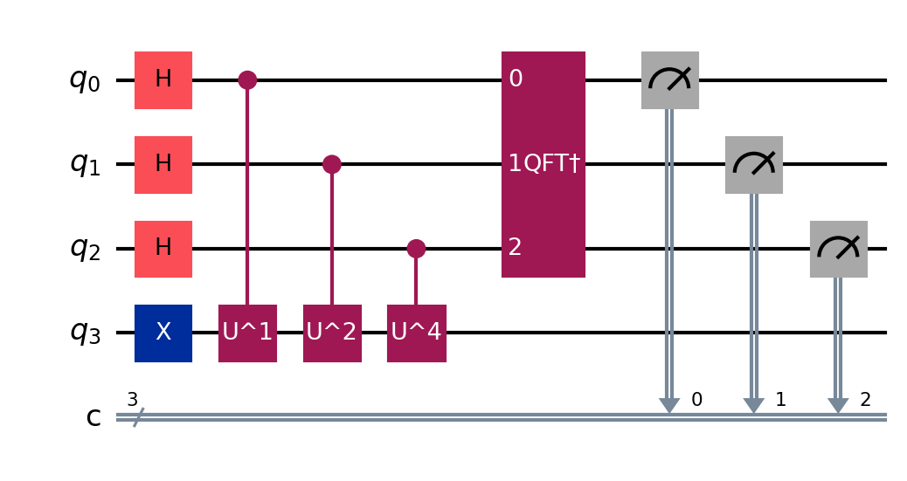

# Quantum Phase Estimation: Simulation and Analysis

A Python-based implementation and simulation of the **Quantum Phase Estimation (QPE) algorithm** using Qiskit. This project investigates phase estimation for exact and inexact phases, studies precision scaling with the number of counting qubits, and compares numerical simulation results with theoretical probability distributions.

## 1. Project Overview

Quantum Phase Estimation is a fundamental quantum algorithm used to estimate the eigenphase of a unitary operator.

Given a unitary operator $U$ and an eigenstate $|\psi\rangle$ satisfying:

$$
U|\psi\rangle=e^{2\pi i\theta}|\psi\rangle
$$

The objective is to estimate the phase $\theta\in[0,1)$.

This project implements QPE using quantum circuits and simulates its behaviour under different phase conditions.

The implementation investigates:

- Exact phase estimation for $\theta=1/8$.
- Inexact phase estimation for $\theta=1/3$.
- Precision scaling with varying numbers of counting qubits.
- Theoretical versus simulated probability distributions.
- Quantum circuit structure and circuit statistics.

## 2. Theoretical Background

The QPE algorithm consists of four main stages:

1. **Eigenstate preparation:** Prepare the eigenstate of the unitary operator.
2. **Superposition:** Apply Hadamard gates to the counting register.
3. **Controlled unitary operations:** Apply controlled powers of the unitary operator, $U^{2^k}$.
4. **Inverse Quantum Fourier Transform:** Apply the inverse QFT to the counting register and measure the resulting state.

For $n$ counting qubits, the phase estimate is obtained from the measured integer $m$ as:

$$
\hat{\theta}=\frac{m}{2^n}
$$

The nominal phase resolution is:

$$
\Delta\theta=\frac{1}{2^n}
$$

When the phase is exactly representable with $n$ counting qubits, QPE can return the exact phase. Otherwise, the measurement outcomes follow a probability distribution centred around the true phase.

### Probability Distribution

For a phase $\theta$, the theoretical probability of measuring integer $m$ is:

$$
P(m|\theta)=
\left|
\frac{1}{2^n}
\sum_{k=0}^{2^n-1}
e^{2\pi i k(\theta-m/2^n)}
\right|^2
$$

Equivalently:

$$
P(m|\theta)=
\left|
\frac{
\sin\left(\pi 2^n(\theta-m/2^n)\right)
}{
2^n\sin\left(\pi(\theta-m/2^n)\right)
}
\right|^2
$$

The limiting value is used when the denominator vanishes.

This distribution is used to compare theoretical predictions with numerical simulation results.

## 3. Implementation

The project is implemented in Python using Qiskit and its Aer simulator.

### Main Components

| Component | Description |
|---|---|
| `inverse_qft()` | Constructs the inverse Quantum Fourier Transform. |
| `qpe_circuit()` | Builds the complete QPE quantum circuit. |
| `run_qpe()` | Executes the circuit using the Aer simulator. |
| `phase_unitary()` | Constructs the unitary phase operator. |
| `theory_distribution()` | Calculates theoretical measurement probabilities. |
| `counts_to_probs()` | Converts measurement counts into empirical probabilities. |
| `draw_circuit_image()` | Generates a visual representation of the quantum circuit. |

### Simulation Parameters

- Simulator: Qiskit Aer
- Measurement shots: 4096
- Initial eigenstate: $|1\rangle$
- Unitary operator:

$$
U(\theta)=
\begin{pmatrix}
1&0\\
0&e^{2\pi i\theta}
\end{pmatrix}
$$

- Counting qubits: 2 to 8 for precision scaling.
- Exact and inexact phase experiments: 5 counting qubits.

## 4. Experimental Investigations

### Experiment 1: Exact Phase Estimation

The first experiment considers:

$$
\theta=\frac18
$$

With five counting qubits, the phase is exactly representable because:

$$
\frac18=\frac{4}{32}
$$

The expected measurement outcome is therefore:

$$
m=4
$$

The simulation examines the measurement distribution and estimation error.



### Experiment 2: Inexact Phase Estimation

The second experiment considers:

$$
\theta=\frac13
$$

Since $1/3$ cannot be represented exactly using a finite binary expansion, the measurement outcomes are distributed around the nearest representable phase values.

The resulting empirical probability distribution is compared with the theoretical probability distribution.



### Experiment 3: Precision Scaling

The third experiment investigates how the phase estimation precision changes with the number of counting qubits.

The number of counting qubits is varied from:

$$
n=2,3,\ldots,8
$$

The nominal phase resolution scales as:

$$
\Delta\theta=\frac{1}{2^n}
$$

The estimation error is examined as a function of the number of counting qubits.



### Experiment 4: Quantum Circuit Visualization

A three-counting-qubit QPE circuit is generated and visualized to examine the circuit structure, including eigenstate preparation, controlled unitary operations, inverse QFT, and measurement.



## 5. Results and Data

The simulation generates the following output files:

| File | Description |
|---|---|
| `qpe_histograms.png` | Measurement distributions for exact and inexact phases. |
| `qpe_theory_vs_sim.png` | Comparison between theoretical and simulated probabilities. |
| `qpe_precision_scaling.png` | Estimation error versus counting qubits. |
| `qpe_circuit_n3.png` | Three-counting-qubit QPE circuit diagram. |
| `qpe_results.json` | Structured numerical results, measurement counts, precision scaling, and circuit statistics. |

### Total Variation Distance

The total variation distance is calculated to quantify the difference between the empirical and theoretical probability distributions:

$$
D_{\mathrm{TV}}(P,Q)
=
\frac{1}{2}\sum_m |P(m)-Q(m)|
$$

This provides a quantitative measure of the agreement between the simulated and theoretical distributions.

## 6. Installation and Requirements

Python 3.10 or later is recommended.

### Clone the Repository

```bash
git clone https://github.com/harshpandey17/quantum-phase-estimation-simulation.git
```

Navigate to the project directory:

```bash
cd quantum-phase-estimation-simulation
```

Install the required dependencies:

```bash
pip install -r requirements.txt
```

### Dependencies

- Qiskit
- Qiskit Aer
- NumPy
- Matplotlib
- pylatexenc

## 7. Running the Simulation

Execute the main Python script:

```bash
python qpe_simulation.py
```

The program performs the experiments, generates the visualizations, saves structured numerical results, and displays the simulation plots.

Generated output files are saved in the project directory.

## 8. Technologies Used

- **Python:** Core programming language.
- **Qiskit:** Quantum circuit construction and manipulation.
- **Qiskit Aer:** Quantum circuit simulation.
- **NumPy:** Numerical computation and probability analysis.
- **Matplotlib:** Data visualization.

## 9. References

1. Nielsen, M. A., and Chuang, I. L., *Quantum Computation and Quantum Information*, Cambridge University Press.
2. Kitaev, A. Y., *Quantum Measurements and the Abelian Stabilizer Problem*, 1995.

## 10. Author

**Harsh Pandey**

B.Tech Engineering Physics  
Delhi Technological University (DTU)

GitHub: [@harshpandey17](https://github.com/harshpandey17)

---

*This project is an exploration of quantum algorithm implementation, numerical simulation, and computational analysis of Quantum Phase Estimation.*
